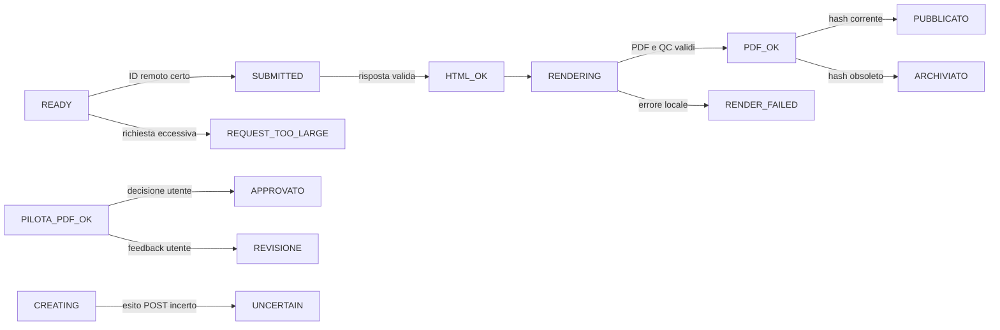

# Innovazioni locali: audit della baseline

Data: 28 ottobre 2026. Ambito scelto dall'utente: app Mac e OpenAI esistenti,
senza nuovi servizi cloud, API grafiche o spese automatiche. I due documenti
cloud allegati descrivono un'alternativa futura: l'elaborazione a Mac spento e
l'approvazione del pilota dal telefono non fanno parte di questo intervento.

## Sorgente attivo e prove

Il repository contiene i sorgenti della versione 2026.10.13 estratti da
`Sorgenti.zip`. Il bundle `.app` non è nel repository, quindi l'eseguibile
macOS distribuito e l'aspetto finale sul Mac richiedono una prova separata.
La suite baseline, eseguita in Linux senza API reali con
`PYTHONPATH=/workspace/.schemi-deps python -m unittest discover -s tests -q`,
ha superato 65 test il 28 ottobre 2026. Questo risultato non certifica il
funzionamento della GUI macOS o dei nuovi moduli illustrativi.

## Mappa essenziale

| Responsabilità | Sorgente autorevole |
| --- | --- |
| GUI e PDF pilota | `scripts/native_app.py`, `scripts/local_app.py` |
| Input e pianificazione | `scripts/ingest.py`, `scripts/planner.py`, `scripts/packs.py` |
| Job, hash, Batch, rendering | `scripts/pipeline.py`, `scripts/remote.py` |
| Stato leggibile, worker, recupero | `scripts/monitor.py`, `scripts/background_worker.py`, `scripts/rescue.py` |
| PDF e QC | `scripts/finalize_pdf.py`, `renderer/render_pdf.py`, `scripts/qc_pdf.py`, `scripts/exports.py` |

La pipeline salva lo stato in `esami/<slug>/state/pipeline.json` e conserva
richieste, risposte e PDF versionati. I nuovi eventi di osservabilità devono
stare accanto a questo stato, senza correggerlo implicitamente.

## Stato già presente e lacune

- Esistono tre gruppi di input, revisione del primo PDF, Batch normale,
  Responses urgente, avvio notturno, hash per versione, stato `PDF_OK`, PDF
  unico e ZIP, heartbeat e recupero locale senza nuove POST.
- `scripts/monitor.py` distingue lavoro locale, remoto osservato e PDF, ma
  non ha eventi e durate per fase, storico comparabile o incidenti tipizzati.
- La GUI è una finestra Tkinter con elenco materie e tre schede. Mancano home
  filtrabile, wizard guidato, anteprima per file, Control Room dettagliata e
  studio di illustrazioni.
- Il rendering può incorporare immagini già presenti nelle fonti, ma non
  esistono planner, registro di licenze, bozze SVG patologiche o revisione
  clinica dell'Illustrator.
- Il report della pipeline contiene titoli e alcuni errori non redatti; non
  deve diventare un pacchetto Codex condiviso automaticamente.

## Transizioni da preservare

Il pilota è collegato a `approved_hash`. Nessuna lettura di Control Room,
report o Illustrator deve chiamare `create_batch` o
`create_urgent_response`. Un `UNCERTAIN` non diventa `READY` senza
riconciliazione certa. Gli eventi registrano osservazioni, non inventano
transizioni.

## Punti di persistenza e concorrenza

`Pipeline.tick()` protegge l'esame con `state/pipeline.lock` e ricarica lo
stato sotto lock. `local_app` e `rescue` rispettano il lock per le modifiche.
`common.write_json()` sostituisce il file tramite temporaneo e `os.replace`.
Il worker usa thread locali e un heartbeat sul disco. I nuovi moduli devono
usare file separati, scritture atomiche e letture che non prendano lock in
ordine inverso alla pipeline. La telemetria deve poter fallire senza bloccare
un PDF o provocare un nuovo invio remoto.

## Decisioni e rischio

| Decisione | Motivo | Rischio residuo |
| --- | --- | --- |
| Restare su Tkinter | Compatibilità con launcher e GUI attuale | Verifica visiva necessaria su macOS |
| Eventi SQLite affiancati | Stato pipeline e progetti storici invariati | Contesa disco da misurare |
| Illustrator locale opzionale | Nessuna nuova API o spesa | Bozze schematiche, revisione medica umana necessaria |
| Nessun inserimento automatico delle bozze nei PDF | Non attribuire validità clinica a una figura non verificata | Inserimento futuro da progettare |
| Nessuna installazione esterna obbligatoria | Pillow e PyMuPDF sono già dipendenze del progetto | 3D e segmentazione non disponibili nel primo rilascio |

La telemetria, le letture di stato e le proposte di figure devono essere
reversibili disattivando i nuovi componenti. Non si migrano in place
`pipeline.json`, `esame.json`, HTML, PDF, JSONL o identificativi remoti.
Le aree più rischiose da toccare sono `advance_remote`, `consume`,
`render_ready`, `publish`, `review_pilot` e le opzioni pinned dei vecchi esami.

## Medical Illustrator: strumenti

| Strumento | Installazione ora | Uso previsto | Limiti |
| --- | --- | --- | --- |
| SVG tramite libreria standard Python | Nessuna | Diagrammi e label editabili, offline | Non è un atlante anatomico accurato |
| Pillow / PyMuPDF | Già nel progetto | Anteprima, raster e PDF | Non creano anatomia da soli |
| Inkscape | Facoltativa, non richiesta | Editing vettoriale avanzato | CLI e resa Mac da verificare |
| Blender | Facoltativa, non richiesta | 3D con asset licenziati | Curva di lavoro e risorse elevate |
| 3D Slicer | Facoltativa, non richiesta | Dati anatomici e segmentazione | Richiede dataset adatto |
| ImageMagick | Facoltativa, non richiesta | Compositing supplementare | Pillow copre il primo prototipo |

Il prototipo può proporre tavole e creare soltanto bozze schematiche locali.
La presenza di una figura non prova correttezza clinica, licenza di un asset
esterno o idoneità per il PDF. Ogni tavola destinata allo studio richiede
controllo umano di lato, vista, struttura, patologia, etichette e fonti.

## Ordine di lavoro e criteri

1. Telemetria locale minima con clock monotono e nessun side effect remoto;
   prova su fixture e registrazione resistente a riavvio.
2. Lettura Control Room con stato corrente, storico e dati mancanti dichiarati;
   nessuna POST durante l'apertura.
3. Diagnostica redatta e recupero locale guidato; nessun invio a Codex senza
   preview e azione separata.
4. Home, wizard e materiali con stato verificabile; vecchi esami leggibili.
5. Illustrator MVP: proposte conservative, SVG editabile, QC tecnico,
   approvazione esplicita e nessun inserimento implicito nel PDF.
6. QC visivo e integrazione grafica avanzata solo dopo prove su Mac con
   contenuti fittizi e font/licenze verificati.

Le fasi cloud dei documenti allegati sono escluse dalla sequenza corrente.
